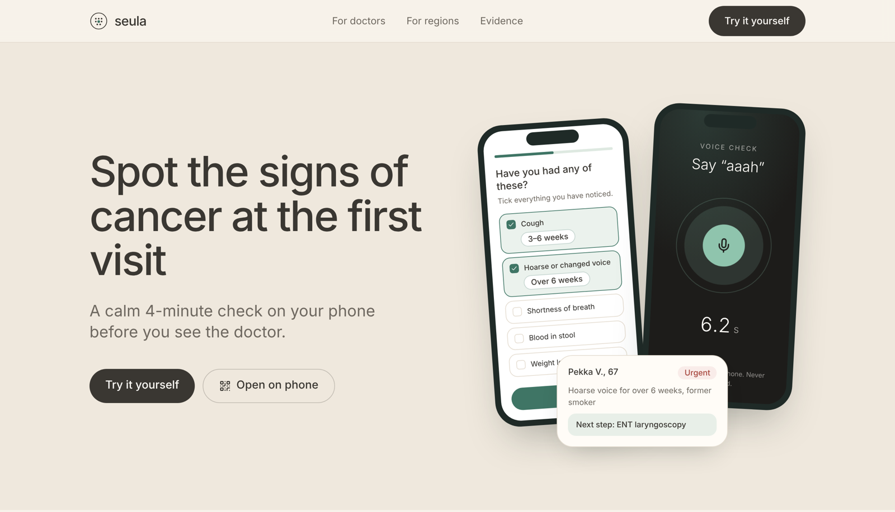

<div align="center">



# SEULA

**Spot the signs of cancer at the first visit.**

A 4-minute pre-visit check on the patient's own phone: symptom questions plus a 3-second voice test.<br>
The GP gets a sorted list, a ready-written history and a suggested next step.

### [Open the live demo &rarr;](https://latt33.github.io/SEULA/)

[Try it yourself](https://latt33.github.io/SEULA/#/check) · [Doctor's view](https://latt33.github.io/SEULA/#/clinician) · [For regions](https://latt33.github.io/SEULA/#/region) · [Evidence](https://latt33.github.io/SEULA/#/evidence)

Junction 2026 · AstraZeneca challenge: *equitable and effective cancer care in Finland*<br>
X-ray pre-read by **MedGemma** (open medical Gemma) on **Modal** serverless GPUs<br>
Built from scratch on the same principle as [PUHELU](https://github.com/Latt33/PUHELU). *Seula* is Finnish for *sieve*.

</div>

---

> **Ready to use as it is.** SEULA is a static web page. A county puts the link in the booking text message it already sends, and the GP pastes the finished history into any patient record system. No app to install, no new hardware, no integration needed on day one. When the county wants integration, the FHIR R4 output is already there.

---

## The problem

In Finland, cancer is often found late, and how late depends on where you live and how much you earn.

| | |
|---|---|
| **16.7%** | of Finnish men with lung cancer are alive after 5 years. Sweden: 26.8% (Acta Oncol 2025) |
| **27%** | of lung cancer patients get treatment that aims to cure (quality registry 2019–2023) |
| **19.3–32.1%** | of residents, depending on the region, feel they get too little doctor time (THL Terve Suomi 2024) |
| **127 vs 76 days** | median from first symptom to treatment via public primary care vs private or occupational care; income decides the first door (lymphoma, Kuitunen et al., Cancer Medicine 2026) |
| **61%** | of lung cancer delay happens before the patient even sees a GP (Kotecha, BJGP Open 2021) |

The slowest route, public primary care, serves the people with the least. The warning signs are there at the first visit. They get lost because the visit is short, the history is taken from scratch and the signs depend on what the patient remembers to mention.

## What SEULA does

1. **At home.** The patient opens the link from their booking SMS and answers short, validated symptom questions in Finnish, Swedish or English.
2. **Three seconds of "aaah".** The phone measures how steady the voice is. The audio is analysed on the phone and never uploaded.
3. **At the visit.** The GP sees a list sorted by urgency, the reasons behind each flag with the guideline that triggered it, a suggested next step (chest X-ray, FIT, laryngoscopy) and a history to paste straight into the record.
4. **Moving the patient on.** When there is a cancer risk, SEULA drafts the referral from the answers, scores and guideline rule. The doctor reviews and sends it, and SEULA follows the patient until the specialist visit, alerting the health station if nothing is booked within two weeks.

The region gets a dashboard of days from first symptom to doctor, per health station, so a growing delay shows up within weeks instead of in next year's statistics.

## What is new

- **Voice before the first visit.** Hoarseness is often the first sign of glottic cancer, the most common laryngeal cancer. Voice clarity (CPPS) is the best-validated acoustic measure of it, but today it is measured in voice labs after referral. SEULA takes the same measurement on the patient's own phone before the GP has seen them.
- **Lab-grade measurement in a browser.** The voice engine is our own TypeScript implementation, calibrated against Praat, the clinical reference tool. It runs fully on the device.
- **Free text that catches what checkboxes miss.** "My voice has been hoarse for two months" in a comment box becomes an "ask about this" note for the doctor, with negation handling in Finnish and English.
- **Screening and workflow in one.** The same form that finds red flags also saves the doctor history-taking time, so the visit pays for the screening.

## Where the AI is

- **Language understanding:** reads free text and dictation (Finnish and English), handles negation and third-person mentions, and surfaces red flags the patient forgot to tick (held-out precision 0.87, recall 0.77).
- **Machine listening:** on-device speech signal analysis extracts clinical voice biomarkers (CPPS, HNR, jitter, shimmer), calibrated against Praat.
- **Medical vision (MedGemma on Modal):** after the flag, Google's open MedGemma 1.5 4B pre-reads the chest X-ray on a serverless Modal GPU, compares it with the earlier one, boxes the finding and reorders the radiologist's worklist ([details](#medgemma-on-modal-from-flag-to-diagnosis)).
- **Rules where accountability matters:** triage uses published guideline rules (NG12, PLCOm2012), so every flag is explainable. AI adds signal; it never raises urgency on its own.

## MedGemma on Modal: from flag to diagnosis

SEULA's flag books a chest X-ray. Then the next queue starts: the X-ray waits in the radiologist's worklist in arrival order. **MedGemma 1.5 4B**, Google's open medical Gemma, pre-reads every X-ray SEULA ordered and moves the ones that need a CT to the top of the list. Open the [doctor's view](https://latt33.github.io/SEULA/#/clinician), pick Matti and watch it happen live: the scan runs over his X-ray, a box is drawn on the mass, and he rises from 4th to 1st on the radiologist's worklist.

### How we use Gemma

One small model, five steps, each one checked by the next:

| Step | MedGemma input | Output |
|---|---|---|
| 1. Read | X-ray + SEULA's reasons for the referral (age, symptoms, guideline rule) | Draft findings and impression |
| 2. Compare | Earlier X-ray + today's X-ray | What is new since last time ("new right upper lobe mass") |
| 3. Name | Its own report, text only | The single finding to locate, or NONE |
| 4. Locate | X-ray + that finding | A box on the image (`box_2d`, 0–1000) |
| 5. Decide | Report + comparison, text only | Yes/no: chest CT within 2 weeks |

- **Grounded in its own words.** The box is drawn for the finding named in MedGemma's own report, so the picture and the text cannot disagree. A box covering most of the image is thrown away, and normal X-rays get no box.
- **Context from the pathway, not just pixels.** The read is primed with the reasons SEULA flagged the patient, the same way a radiologist reads the referral before the image.
- **Longitudinal, not one-shot.** Multi-image input lets MedGemma compare with the earlier X-ray, which is how radiologists actually decide that something is new.
- **Checked against radiologists.** The demo X-rays come from NIH ChestX-ray14, which includes radiologist-drawn boxes. The doctor's view shows MedGemma's box over the NIH box: on Matti's X-ray it contains 100% of the area the radiologist marked, and both demo cases get the right priority.
- **Why a 4B open model.** It fits on one 24 GB GPU, so a county or hospital district can run it on its own hardware and X-rays never leave Finland. No per-call API fees and no data processor outside the EU.
- **Pre-read only.** A radiologist reports every image. MedGemma changes the order of the list, never the diagnosis, and the doctor sees the reasoning in plain text.

### How we use Modal

The whole GPU service is one Python file, [`medgemma/app.py`](medgemma/app.py), deployed with `modal deploy`:

- **Serverless GPU that scales to zero.** `@app.cls` loads MedGemma once per container (`@modal.enter`) and keeps it warm for 15 minutes; with no X-rays to read it costs nothing. A warm read takes about 4–8 seconds for all five steps.
- **Never stuck waiting for a GPU.** A fallback list (`gpu=["L4", "A10G", "L40S", "A100-40GB"]`) takes the first free card.
- **Fast cold starts.** Model weights live in a Modal Volume, so a new container loads from cache instead of downloading 8 GB from Hugging Face.
- **Warm before the doctor clicks.** Opening the doctor's view calls `/warmup`, which `spawn`s a GPU container in the background while the doctor reads the history.
- **A web API from the same file.** A FastAPI app (`@modal.asgi_app`) serves `/read` to the static GitHub Pages site, with CORS limited to our origin.
- **Safe to leave public.** The Hugging Face token is a Modal Secret. Only the three demo X-rays are accepted (SHA-256 allowlist), at most one GPU runs (`max_containers=1`) and a Modal Dict holds a global quota of 40 reads per hour, so the URL cannot be used as a free MedGemma API.
- **Same container, county hardware.** The pilot deployment drops the allowlist and runs the same image inside the hospital district's network.

If the endpoint is off, the site shows MedGemma results recorded from the same service, so the demo always works.

Run it:

```bash
pip install modal && modal setup
# accept the terms on https://huggingface.co/google/medgemma-1.5-4b-it, then:
modal secret create huggingface HF_TOKEN=hf_...
modal deploy medgemma/app.py                  # prints https://<you>--seula-medgemma-web.modal.run
python medgemma/record.py <that url>          # optional: saves results as an offline fallback
```

Then set the repository variable `MEDGEMMA_URL` (Settings → Secrets and variables → Actions → Variables) and push, or open the site once with `?medgemma=<url>`.

X-ray images: NIH ChestX-ray14, NIH Clinical Center (https://nihcc.app.box.com/v/ChestXray-NIHCC); Wang et al., *ChestX-ray8*, CVPR 2017.

## National cancer strategy, Goal 3

| Action | Goal 3 indicator |
|---|---|
| R1 Link with every non-urgent GP booking, lower-income areas first | 3.5.3 |
| R2 Nurses book the 2-week test from a flag; R3 fast-track laryngoscopy | 3.1.2 |
| R4 G8 and EQ-5D-5L on every referral 70+ | 3.4.2 / 3.3.1 |
| R5 Symptom-to-test days per station and by income group, alert at 28 days | 3.1.2 / 3.2.2 |
| R6 Comparator county with Cancer Registry linkage, results by education and income | 3.2 |

## How it scales

| | |
|---|---|
| **Delivery** | A link in an SMS the county already sends. Works on any smartphone browser. |
| **Cost** | About €0.50 per form (SMS and hosting). No devices, no new staff. |
| **Integration** | Day one: copy-paste into any record system. Later: HL7 FHIR R4 `QuestionnaireResponse`, already exported by the demo. |
| **National roll-out** | One static site; could be offered through Omaolo so every county gets it without its own procurement. |
| **Fallback** | No smartphone? A nurse asks the same questions by phone, the PUHELU model. |
| **Equity** | Start at health stations serving lower-income postcode areas (Statistics Finland Paavo). In production, the booking system sends the link automatically and registry linkage reports delays by income group. |
| **Example region** | 40,000 forms a year: about 1,333 doctor hours freed, 1,600 people sent for a test within two weeks, about €70k net saving after all costs (adjustable model on the [impact page](https://latt33.github.io/SEULA/#/impact)). |

Six concrete actions for a county, each with an owner, timeline and success measure, are on the [recommendations page](https://latt33.github.io/SEULA/#/pilot).

## What it is built on

Only published guidelines and validated instruments. Every flag in the app shows its rule and links to its source.

| Instrument | Used for |
|---|---|
| NICE NG12 suspected-cancer rules | Lung, colorectal, laryngeal and upper-GI red flags |
| PLCOm2012 (threshold 1.51%) | 6-year lung cancer risk in people who have ever smoked |
| VHI-10 | Self-rated voice handicap |
| G8 | Frailty screen for patients 70+ |
| EQ-5D-5L | Health-related quality of life profile for referrals |
| CPPS, HNR, jitter, shimmer, F0 | Acoustic voice measures |

Supporting research includes Maryn et al. 2009 (CPPS the most valid single voice measure), Murton et al. 2020 (CPPS cut-off, AUC 0.93), Jannetts et al. 2019 and Uloza et al. 2023 (phone microphones match studio microphones), Kim et al. 2024 and Paterson et al. 2025 (voice and laryngeal disease) and the UK QCancer tools running in 4,000+ practices. The full list is on the [evidence page](https://latt33.github.io/SEULA/#/evidence) and in `src/data/sources.ts`.

## How it performs

**Voice engine vs Praat 6.1** (240 synthetic sustained vowels, calibrated on one half, tested on the held-out half):

<div align="center">

| HNR | Shimmer | CPPS | F0 | Jitter |
|:-:|:-:|:-:|:-:|:-:|
| r = 1.00 | r = 0.96 | r = 0.95 | r = 0.95 | r = 0.94 |

</div>

**Free-text symptom extraction** (Finnish and English, held-out set): precision 0.87, recall 0.77.

**What voice can and cannot do.** CPPS separates dysphonic from normal voices (AUC 0.93), so it is useful for deciding who needs a laryngoscopy. It does not tell cancer from a benign lesion; the laryngoscopy does. Voice and free text therefore never raise the urgency on their own. The questionnaire carries lung and colorectal cancer.

## How to use it

**Try the demo:** open [latt33.github.io/SEULA](https://latt33.github.io/SEULA/), press *Try it yourself* (or *Open on phone* for a QR code), then see the result in the *For doctors* view.

**Run it locally:**

```bash
npm install
npm run dev      # http://localhost:5173 (add --host to open it on a phone on the same Wi-Fi)
npm run build    # static site in dist/, runs on any static host
```

The microphone needs HTTPS or localhost. Pushing to `main` deploys to GitHub Pages through the included workflow.

**Reproduce the evidence:**

```bash
pip install -r analysis/requirements.txt
python3 analysis/validate_voice.py --n 240                  # voice engine vs Praat
python3 analysis/validate_voice.py --voiced path/to/voiced  # optional: PhysioNet VOICED database
npx tsx analysis/node/text_eval.ts                          # symptom extraction
```

<details>
<summary><b>Code map</b></summary>

| Path | What |
|---|---|
| `src/engine/questionnaire.ts` | NG12 rules, PLCOm2012, VHI-10, G8, EQ-5D-5L, free-text symptom extraction |
| `src/engine/voice.ts` | On-device voice analysis and spectrogram |
| `src/engine/report.ts` | Patient-record history (EN/FI) and FHIR R4 output |
| `src/engine/impact.ts` | Impact model and combined-AUC explorer |
| `src/pages/` | Home, patient form, doctor's view, regions, impact, evidence, recommendations |
| `analysis/` | Voice validation against Praat and text extraction evaluation |

</details>

## Design rules

1. Only validated instruments and published guideline rules.
2. Voice and free text never raise the urgency on their own; they give the doctor questions to ask.
3. Audio never leaves the phone. Only numbers are stored.
4. The patient never sees a risk score and always gets the 116117 safety-net number.

## Limitations

- NG12 is a UK guideline, used until FICAN publishes Finnish pathway criteria (roadmap action 3.1.2).
- The voice engine is validated against Praat on synthetic voices. Clinical accuracy is what the pilot measures.
- Finnish VHI-10, G8 and EQ-5D wording in the demo are unofficial; production needs the validated versions and a EuroQol licence.
- Research prototype, not a medical device. Decision support like this is likely MDR class IIa.

---

<div align="center">

**Team:** Atte Laakso · Nikolas Juhava · Konsta Kiirikki · Qilun Li

</div>
